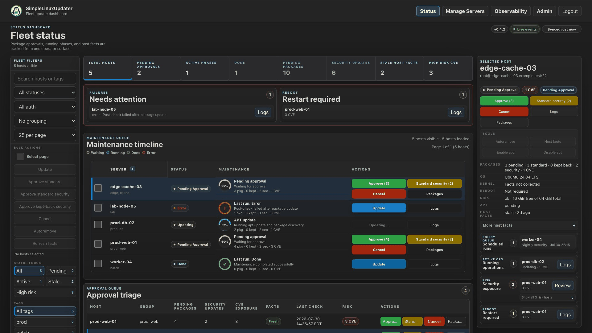

# SimpleLinuxUpdater

Version: v0.5.0

SimpleLinuxUpdater is a self-hosted web UI that helps you manage apt updates on Debian-based servers over SSH. It provides an approval workflow, health checks, audit history, and basic observability so you can update hosts confidently without logging into each machine.

[](LICENSE)
[](https://go.dev/dl/)
[](https://github.com/NoLife141-Teams/SimpleLinuxUpdater/actions/workflows/ci.yml)



## Table of contents

- [Overview](#overview)
- [Features](#features)
- [Upgrading to v0.5.0](#upgrading-to-v050)
- [Quick start](#quick-start)
- [Documentation](#documentation)
- [Security](#security)
- [Contributing](#contributing)
- [License](#license)

## Overview

SimpleLinuxUpdater is designed for trusted environments (LAN/VPN). It connects to your servers via SSH and runs apt operations directly for root SSH sessions or with sudo for non-root users. Updates are gated behind `pending_approval`, and the UI surfaces checks, logs, and audit events.

## Features

- Named local accounts with reader/operator/administrator permissions, optional TOTP MFA and scoped personal API tokens ([permissions, migration, recovery and automation](docs/personal-api.md), [OpenAPI v1](docs/openapi-v1.json)). Existing installations keep their administrator password and sign in again once after migration.
- Multi-server management (custom SSH ports supported)
- Read-only onboarding checks with [managed helper export from binary archives or Docker](docs/usage.md#managed-helper-installation) for fresh non-root targets
- Inventory JSON v1 and complete filtered audit JSON/CSV exports without secrets ([workflow and bounds](docs/usage.md#export-inventories-and-audit-searches))
- CSV/JSON inventory import with normalized previews, row selection, atomic creation and disabled-by-default servers ([format and workflow](docs/usage.md#import-an-inventory))
- Select up to 1,000 explicit hosts in Manage for atomic tag and availability changes, with per-host policy schedule previews and a separate confirmation ([bulk workflow](docs/usage.md#bulk-inventory-administration)).
- Enable or disable servers from Manage Servers. Disabling preserves credentials and history while blocking manual maintenance, scheduled runs, and automatic host-facts refreshes. Finish or cancel any active operation before disabling a server; re-enable it to resume normal scheduling.
- `apt update` + pending package listing, gated behind approval
- Four explicit approval scopes: standard updates, standard security updates, kept-back security updates, or a full upgrade with package-removal confirmation
- Expiring package deferrals per Server and policy, with reasons, audit authors, cumulative inheritance, dependency-safe plans and enforcement before dpkg ([workflow](docs/usage.md#package-deferrals))
- Approval bound to the displayed job and plan generation, revalidation before execution, and APT enforcement when removals are not approved
- Distribution-verified CVE assessment for Debian 12/13 and Ubuntu 22.04/24.04/26.04, with fixes and remaining exposure shown separately
- Baseline and plan-aware disk/APT pre-checks before approval, including exact simulated size facts with a conservative fallback, plus post-update health checks
- Durable APT reconciliation and guided repair after uncertain package-manager outcomes
- Controlled reboot with SSH recovery, uptime reset, and reboot-required verification
- Per-server Recommended action guidance on Status and immediate eligibility-aware bulk actions
- Daily, weekly, monthly and one-time policies with canonical timezone previews, maintenance windows, explicit or automatic canaries, and durable success-gated rollouts ([scheduling and recovery](docs/usage.md#policy-schedule-cadences-and-recovery))
- Generic webhook, Discord, and Telegram notifications with delivery diagnostics, opt-in approval/reboot/backup alerts, and optional grouped reminders ([configuration and lifecycle](docs/usage.md#notification-hooks))
- On-demand `apt autoremove` and independent scheduled cleanup policies
- Activity history (audit trail) stored in SQLite
- Observability: `/observability` dashboard and Prometheus `GET /metrics`
- Built-in named local accounts with first-run administrator setup, Argon2id password hashing, optional TOTP MFA, and isolated SQLite-backed sessions
- Local administrator password recovery with hidden terminal entry, exclusive installation locking and atomic session revocation/audit; see [lost access recovery](docs/troubleshooting.md#forgotten-admin-password)
- In-app encrypted backup/restore (DB + config, optional `known_hosts`) for host/container migration

## Upgrading to v0.5.0

Before replacing v0.4.16, export and verify an encrypted backup. This release
migrates account and scheduling data, signs out old sessions once, and adds
protocol 3 requirements for package deferrals. Follow the
[upgrade, restore and rollback guide](docs/upgrading.md) and
[release compatibility notes](CHANGELOG.md#upgrade-notes).

## Quick start

### Docker (official image)

```bash
cp .env-template .env
docker pull ghcr.io/nolife141-teams/simplelinuxupdater:v0.5.0
docker run --env-file .env -p 8080:8080 -v debian-updater-data:/data ghcr.io/nolife141-teams/simplelinuxupdater:v0.5.0
```

Open `http://localhost:8080`.

On first run, you will be redirected to `/setup` to create the local admin account.
After setup, sign in at `/login`.

The container image explicitly sets `DEBIAN_UPDATER_LISTEN_ADDR=:8080` so its
published port remains reachable. A directly launched binary defaults to
`127.0.0.1:8080`; set `DEBIAN_UPDATER_LISTEN_ADDR` only when another bind address
is required. If first-run setup is exposed beyond loopback, limit access to the
intended LAN, VPN, or authenticated reverse proxy rather than the public internet.

For Prometheus, configure your scraper with:

- `Authorization: Bearer <token-created-in-admin-page>`

Metrics token flow:

- `/metrics` is disabled by default.
- Sign in, go to `/admin`, then generate or rotate the Metrics API token.
- The token is shown once. Store it in your scraper secret manager.

Backup/restore flow:

- Sign in and open `/admin` -> **Backup & Restore**.
- Export creates one encrypted backup file (`.slubkp`) containing:
  - `servers.db`
  - `config.json`
  - optional `known_hosts` (toggle at export time)
- Restore applies immediately (no restart required), replaces `servers.db` and optional `known_hosts`, validates backup `config.json`, and re-encrypts restored secrets with the local `config.json` key.
- Verify the downloaded archive in Admin before restore; verification checks the manifest and decryptability without changing application state.
- The backup passphrase is not stored by the app; keep it in your secret manager.
- Optional automated backups are disabled by default. Set `DEBIAN_UPDATER_BACKUP_DIR` to an absolute, dedicated archive directory and `DEBIAN_UPDATER_BACKUP_PASSPHRASE_FILE` to an absolute private secret file outside that directory. Both must be provided together. The directory must be separate from active app data; symlinks are rejected. In Admin, save and validate a daily/weekly schedule and retention (1–100 archives), or run a control backup with scheduling disabled.
- Automated archives are verified before atomic publication; retention only removes recorded, unchanged archives owned by this installation after a new verified publication. Keep the passphrase file in a separate, recoverable secret store: it is never included in backups. Restoring settings suspends automation until local revalidation. See [automated backup configuration](docs/configuration.md#automated-backups).
- Admin can inspect registered automated archives, download their existing encrypted bytes and reverify restore readiness without replacing active data. See the [archive catalog guide](docs/configuration.md#registered-automated-archive-catalog); retain backup passphrase files separately.

Environment variables for auth/session:

- `DEBIAN_UPDATER_SESSION_COOKIE_SECURE`: optional boolean (`true|false`, default `false`), enables secure-only session cookies; set `true` behind HTTPS.
- `DEBIAN_UPDATER_SESSION_IDLE_TIMEOUT_HOURS`: optional integer idle timeout in hours; `0` or unset keeps default behavior.

Environment variables for job logs:

- `DEBIAN_UPDATER_JOB_LOG_RETENTION_DAYS`: completed-job log retention in days (default `30`, allowed `1..3650`). Expiration removes detailed log content while preserving job status, summary, metadata, and timestamps.
- `DEBIAN_UPDATER_JOB_LOG_MAX_BYTES`: maximum detailed log bytes persisted per job (default `2097152`, allowed `131072..1073741824`). Oversized logs retain their first 64 KiB and newest output with an explicit truncation marker.

In-memory SSH diagnostics retain at most 256 KiB per stream plus a truncation marker; the live status log retains 32 KiB. Read-only output that must be parsed completely fails explicitly above 4 MiB per stream. These limits do not reduce the configured persisted job-log limit.

Environment variable for host facts:

- `DEBIAN_UPDATER_HOST_FACTS_AUTO_REFRESH_ENABLED`: optional boolean (`true|false`, default `true`) controlling the periodic sequential refresh worker. Successful updates, controlled reboots, and scheduled scans continue to refresh facts when the worker is disabled.

Programmatic auth note:

- `POST /api/auth/setup`, `POST /api/auth/login`, and `POST /api/auth/logout` require same-origin host checks:
  - At least one of `Origin` or `Referer` must be present
  - Any provided `Origin`/`Referer` host must match request host
  - `Sec-Fetch-Site: same-origin` is recommended and validated when present

### Binary (prebuilt release)

Download the archive for your platform from GitHub Releases and run the included `webserver` binary. Release archives include `templates/`, `static/`, and `.env-template`.

Example (Linux amd64):

```bash
VERSION="0.5.0"
APP="SimpleLinuxUpdater_${VERSION}"
ARCHIVE="${APP}_linux_amd64.tar.gz"

curl -L -o "${ARCHIVE}" "https://github.com/NoLife141-Teams/SimpleLinuxUpdater/releases/download/v${VERSION}/${ARCHIVE}"
tar -xzf "${ARCHIVE}"
cd "${APP}"
./webserver
```

For binary releases, export environment variables in your shell before starting `./webserver`; `.env` files are only consumed when you pass them to Docker with `--env-file`.

## Documentation

- [Documentation map](docs/README.md)
- [Installation](docs/installation.md)
- [Configuration](docs/configuration.md), including [HTTP request budgets](docs/configuration.md#http-request-budgets)
- [Usage](docs/usage.md)
- [Deployment](docs/deployment.md)
- [Upgrade, restore and rollback](docs/upgrading.md)
- [Accounts and API](docs/personal-api.md)
- [Security](docs/security.md)
- [Troubleshooting](docs/troubleshooting.md)
- [Release smoke checklist](docs/release-smoke.md)
- [Computer Use release checklist](docs/computer-use-release-checklist.md)
- [Production manual QA checklist](docs/production-manual-qa-checklist.md)
- [Architecture](docs/architecture.md)
- [Contributing](docs/contributing.md)
- [Frontend adapters and isolated browser tests](docs/frontend-isolation.md)

Choosing between SimpleLinuxUpdater, scripts, and Ansible: see [docs/usage.md](docs/usage.md#how-simplelinuxupdater-compares-to-scripts-and-ansible).

## Security

This project can run apt commands via `sudo` on remote hosts and stores SSH credentials encrypted in SQLite. Do not expose the UI to the public internet. See [docs/security.md](docs/security.md).

Frontend CSP policy:

- UI pages run with strict CSP (`script-src 'self'`, `style-src 'self' https://fonts.googleapis.com`, `font-src 'self' https://fonts.gstatic.com`).
- Inline `<script>`, inline `<style>`, inline `on*=` handlers, and inline `style=` attributes are prohibited.
- CI tests fail if these inline patterns are reintroduced in the main UI templates.
- For local Codex in-app-browser testing only, set `DEBIAN_UPDATER_DEV_ALLOW_BROWSER_ANNOTATIONS=true` before startup. This permits injected inline `<style>` elements through `style-src-elem`; scripts and the default production policy remain strict. Do not enable it on a remotely exposed deployment.

## Contributing

See [docs/contributing.md](docs/contributing.md).

### Looking for help (Linux servers and homelabs)

If you have a Linux server, a homelab, or a small fleet of Debian/Ubuntu machines, your feedback and real-world testing is exactly what this project needs.

Ways you can help:

- Tell me what you want the tool to do next (feature requests and priorities)
- Report bugs with a short description and the relevant logs
- Share what hardware/OS you run (Debian/Ubuntu versions, VPS vs homelab) and what worked or did not
- Suggest safer defaults for checks, approvals, and retries
- Review the UI flow and propose improvements that reduce operational mistakes

## License

MIT. See [LICENSE](LICENSE).

### Installed-package vulnerability scans

Distribution triage, applicability/confidence and CVSS are separate. Debian vendor-qualified findings and Ubuntu OSV triage uncertainty remain visible without being automatically treated as confirmed runtime exposure. See [distribution qualification](docs/usage.md#distribution-qualification-and-confidence).

The selected-host panel exposes a read-only **Scan vulnerabilities** action and persisted coverage, freshness, severity, and findings, including packages with no newer candidate. Never-scanned, unavailable, partial, and complete scans are distinct. Failed scans and updates alone never resolve findings. A partial host scan can resolve a package only with its complete, stable, provenance-verified evaluation proof; unknown packages remain open. Legacy scans without these proofs stay conservative. See [scan behavior and source limits](docs/usage.md#installed-package-vulnerability-scans).

Component context distinguishes development headers, active/inactive installed kernel images and external container-host kernels without asserting runtime exploitability. CVE scope is host OS packages only: Docker images and application dependencies are not scanned, and third-party repositories are not covered. Missing or stale read-only probes remain unknown; no additional privileges or other-host access are requested.

- `DEBIAN_UPDATER_VULNERABILITY_SCAN_ENABLED`: `true` by default; `false` disables manual and periodic installed-package scans. Existing asynchronous approval enrichment is independent.
- `DEBIAN_UPDATER_VULNERABILITY_SCAN_INTERVAL_HOURS`: default `24`, range `0–8760`; `0` disables periodic scans while keeping manual scans available.
- `DEBIAN_UPDATER_VULNERABILITY_SCAN_TIMEOUT_SECONDS`: default `300`, range `10–900`; total inventory/OSV scan deadline.
- `DEBIAN_UPDATER_VULNERABILITY_TARGET_LOW_DAYS`, `DEBIAN_UPDATER_VULNERABILITY_TARGET_MEDIUM_DAYS`, `DEBIAN_UPDATER_VULNERABILITY_TARGET_HIGH_DAYS`, `DEBIAN_UPDATER_VULNERABILITY_TARGET_CRITICAL_DAYS`: optional remediation objectives, `0–3650` days from first observation; unset or `0` means no target. Unknown severity never receives a deadline. These objectives do not gate approvals.

Application post-check profiles in Admin can verify remote systemd units and HTTP health endpoints per Server or tag, with bounded recovery and blocking/warning results. See [profile configuration](docs/configuration.md#application-post-check-profiles).

Developers can run the [real SSH/APT qualification harness](docs/ssh-apt-qualification.md) against disposable Debian/Ubuntu targets. PR CI covers fixture upgrades, trust, approval drift and interrupted-mutation repair; systemd/reboot VM evidence is reported separately.

The [dashboard scaling harness](docs/dashboard-scaling.md) measures synthetic fleets
of 10, 100 and 1,000 Servers through authenticated APIs, Chromium and SSE, with
isolated SQLite fixtures and no SSH connections.

### Installation health

`GET /healthz` reports process liveness. `GET /readyz` reports local runtime and
SQLite readiness with a 250 ms query budget, before setup as well as afterward.
Both are public, read-only, require no account/token, return minimal JSON, and
send `Cache-Control: no-store`. Remote Server failures do not change readiness.
See [deployment health checks](docs/deployment.md#installation-health-and-readiness)
for maintenance states, Docker probes, metrics and alert examples.
