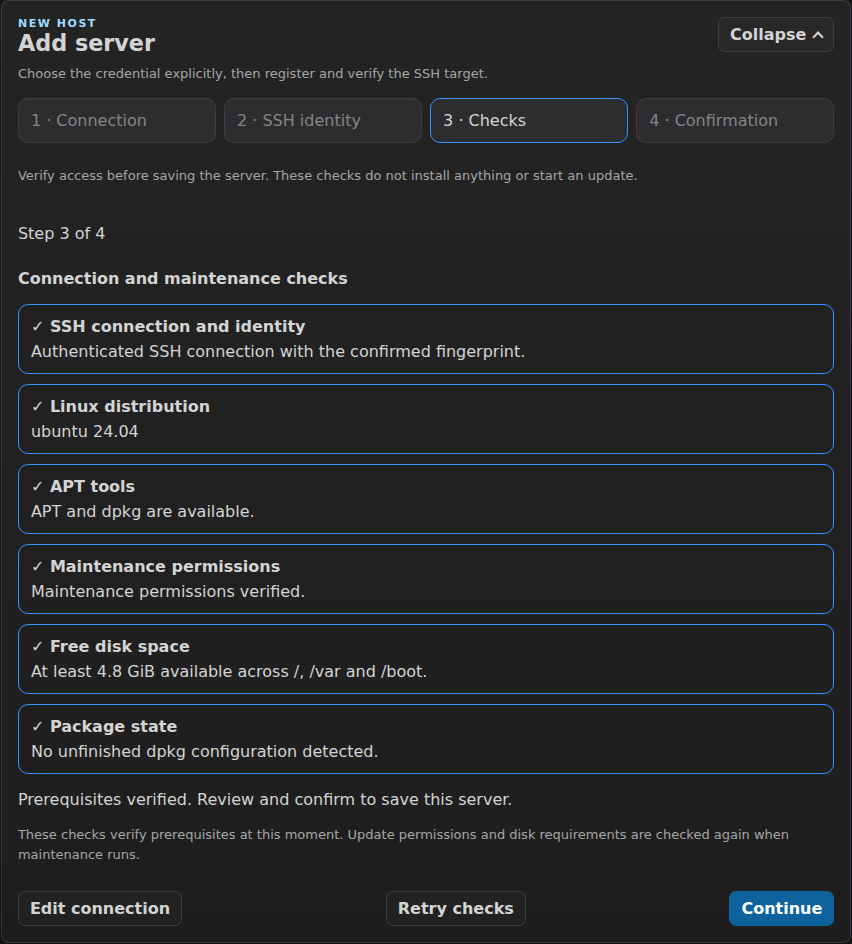
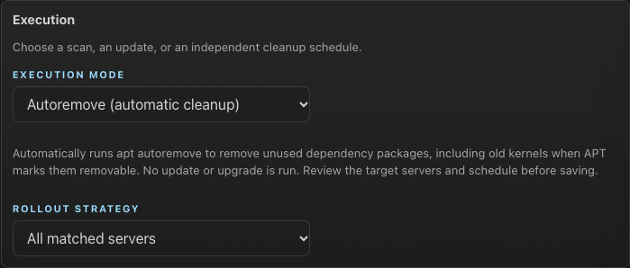

[README](../README.md) | [Installation](installation.md) | [Configuration](configuration.md) | [Usage](usage.md) | [Deployment](deployment.md) | [Security](security.md) | [Troubleshooting](troubleshooting.md) | [Architecture](architecture.md) | [Contributing](contributing.md)

# Usage

## Table of contents

- [Add and manage servers](#add-and-manage-servers)
- [Authentication flow](#authentication-flow)
- [Trust a host key](#trust-a-host-key)
- [Run updates with approval](#run-updates-with-approval)
- [CVE-aware pending approval](#cve-aware-pending-approval)
- [Logs and status](#logs-and-status)
- [Policy schedule cadences and recovery](#policy-schedule-cadences-and-recovery)
- [Scheduled canary and wave rollouts](#scheduled-canary-and-wave-rollouts)
- [Notification hooks](#notification-hooks)
- [Audit trail](#audit-trail)
- [Observability and metrics](#observability-and-metrics)
- [Backup and restore](#backup-and-restore)
- [How SimpleLinuxUpdater compares](#how-simplelinuxupdater-compares-to-scripts-and-ansible)

## Add and manage servers

Use the Manage page to add, edit, or delete servers. Authentication options:

- Password per server
- SSH key per server (uploaded via UI)
- Global SSH key (uploaded via UI and reused when per-server key is missing)

**Add Server** now guides you through four steps:

1. Enter the SSH address, user and selected credential.
2. Compare the scanned SSH fingerprint with a trusted source (for example the
   server console), then explicitly confirm it. Changed or revoked saved keys
   remain blocking errors.
3. Verify authenticated SSH, Debian/Ubuntu, APT/dpkg tools, maintenance
   permissions, free space on `/`, `/var` and `/boot`, and unfinished dpkg
   configuration. Failed checks block saving; correct them and retry or return
   to the connection details. Less than 200 MiB available on any checked
   filesystem blocks adding; less than 1 GiB is a warning.
4. Review and confirm. Checks run again before the SSH identity is trusted and
   the server and selected credential are saved together. No update starts.

Example verification step using test data:



Verification does not refresh package metadata, install the managed helper,
change sudoers, repair packages or reboot. For non-root accounts the permission
check requires the managed helper, checks sudo policy for its `update` and
`upgrade` commands, and runs its read-only `dpkg-audit` command without a
password. This establishes maintenance prerequisites; it cannot guarantee every
future update will succeed. Actual operation permissions, APT locks and disk
requirements are checked again during maintenance.

Authenticated API clients can use `POST /api/servers/onboarding/check` to verify
a draft and `POST /api/servers/onboarding` to verify and create it. Both accept
`name`, `host`, `port`, `user`, `tags`, `auth_method` (`password`,
`per-server-key`, or `global-key`), the applicable `pass` or `key`,
`fingerprint_sha256`, and `confirmed: true`. Draft checks do not persist
credentials or host trust. The existing `POST /api/servers` remains available
for compatible inventory imports without these remote checks.

Use **Disable** in a server's directory row to pause manual maintenance, scheduled
runs, and automatic host-facts refreshes. The server stays in Manage Servers, and its
credentials, tags, policy settings, and history are retained. **Enable** resumes
normal maintenance eligibility. A running action or pending approval must finish
or be cancelled before the server can be disabled. Existing servers remain enabled
when upgrading. The Status page defaults to **Enabled servers**; choose
**Disabled servers** or **All servers** in the Server availability filter to
include paused hosts. This selection is remembered in your browser.

API clients can set the same state with `PUT /api/servers/:name/availability` and
`{"disabled": true}` or `{"disabled": false}`. Ordinary server edits preserve this
setting. Availability changes appear in the audit trail as `server.disable` and
`server.enable`.

## Bulk inventory administration

In Manage → Server directory, select individual hosts using their checkboxes.
Selection starts empty. Pagination retains explicit choices; changing a search,
tag, authentication or grouping filter, or page size, clears selection. The counter and
**Selected hosts** disclosure include choices made on other pages. At most 1,000
hosts can be selected; hidden hosts are never selected automatically.

Enter tags to add/remove and/or choose Enable or Disable, then select **Preview
changes**. Tags use the existing inventory trimming and uniqueness rules. The
resulting host supports up to 64 tags and 4,096 tag characters. The
server returns each host's before/after values, current blocking action and
canonical policy schedule facts, including no-run windows. Review these facts,
choose **Review confirmation**, then **Apply reviewed changes**. Any changed
selection or values requires another preview. Previews expire after 15 minutes
and confirmations are single-use; all selected hosts commit together or none do.
Concurrent inventory/policy changes, missing hosts, active actions and pending
approvals require a new preview. Conflicting current values remain available for
review, and successful batches show per-host before/after facts and a batch ID.

The command changes only tags and availability. It preserves credentials, trust,
post-checks, deferrals, overrides, history and accepted rollout manifests. Future
policy matching uses current tags. The command starts no SSH or maintenance;
enabling hosts resumes normal scheduling and automatic refreshes, so configured
policies may run afterward. Disablement retains existing active-action guards.

If a response is lost, Manage refreshes inventory and audit and marks the result
uncertain. Check those current facts and request a fresh preview before applying
anything else. It never automatically repeats a confirmation. The audit action
is `server.bulk`; all parts retain the batch ID, authenticated actor, selected
count and numbered, lossless JSON fragments of every target's before/after facts.
Concatenate `changes_json_fragment` in `part` order to reconstruct large batches.

The cookie-only administrator endpoints are `POST /api/servers/bulk/preview`
(`names`, `add_tags`, `remove_tags`, optional boolean `disabled`) and
`POST /api/servers/bulk` (`batch_id` from the reviewed preview). Both require
`inventory:write`, same-origin requests and normal maintenance admission.

## Import an inventory

Open **Manage → Import inventory** and download the CSV or JSON example. Choose
your file, select **Validate file**, review normalized values and per-row errors,
then uncheck any unwanted rows. **Review selected rows** opens a separate
confirmation before **Import disabled servers** creates the batch. Switching
Manage sections preserves the import and add-server drafts; **Clear import
draft** discards only the import.

Files must be UTF-8 (an optional UTF-8 BOM is accepted), at most 2 MiB and 1,000
server rows. CSV uses a comma delimiter and the exact, unique headers
`name,host,port,user,tags` in any order. JSON is one array of objects with required
`name`, `host`, `user` strings and optional integer `port` and string-array `tags`.
Unknown fields, duplicate JSON keys, duplicate CSV headers, credentials and host
keys reject the whole file without displaying their contents. Invalid values in
supported fields appear as row errors. Empty CSV ports and omitted/zero JSON
ports default to 22; other ports must be between 1 and 65535.

Tags are a JSON string array in both formats. In CSV, quote the entire cell and
double embedded quotes: `"[""production"",""web""]"`. An empty CSV tags cell is
equivalent to `[]`. Inventory normalization trims tags, removes exact duplicates
and splits commas within each tag: `["prod,web"]` becomes `["prod","web"]`.
Use separate array elements for separate tags; commas cannot be preserved inside
a tag. Names are trimmed, SSH users validated, and IP literals canonicalized.
Duplicate names ignore case; equivalent IP addresses and implicit port 22 are
the same endpoint. The first valid occurrence in the file is selectable; later
duplicates and conflicts with the current inventory are rejected.

Import creates new servers only. Every new server starts **disabled**, with no
per-server credentials or newly trusted SSH identity. Preview and import make no
SSH connections or maintenance requests. After import, use **Configure** to open
the existing editor, set credentials (or use the Global SSH Credential), verify
and trust the fingerprint against a trusted source, then save and explicitly
**Enable** the server in the directory when ready. Existing credentials, host
trust, policy assignments and history are preserved.

The selected rows are checked against current inventory again during
confirmation. The entire batch is saved in one transaction before runtime
publication. A conflict or persistence failure creates no partial batch. Review
the returned preview and confirm a new selection to retry. If a network response
is lost, refresh the directory before retrying; already-created names/endpoints
will be rejected. The `server.import` audit event records the authenticated
actor, batch ID, selected/created counts and created server names, without the
raw file or credentials. It is available in Manage audit presets and Admin
activity. Large batches use numbered audit records with the same batch ID and
total counts so every created server name remains available.

Authenticated API clients can upload raw file bytes to
`POST /api/servers/import/preview?format=csv` (or `json`), then submit
`{"batch_id":"<preview batch_id>","rows":[<selected normalized rows>]}` to
`POST /api/servers/import`. Each selected row contains only `row`, `name`, `host`,
`port`, `user`, `tags`; omit preview `errors`. Success returns HTTP 201 and
`created`; a current-inventory conflict returns HTTP 409 and a refreshed
`preview`. Download fixed documentation examples from
`GET /api/servers/import/example/csv` and `/json`.

## Authentication flow

Browser access uses named local accounts:

1. First run: create the admin account at `/setup`.
2. Sign in at `/login`.
3. Administrators manage reader/operator/admin accounts; each user can configure optional MFA, personal API credentials and their own sessions. See [Accounts and API](personal-api.md).
4. Use the logout action to end the current session.

When upgrading from v0.4.16, sign in again once with the original password. Setup
stays closed. Interrupted approvals need a rescan and fresh approval; follow the
[upgrade, helper update, restore and rollback guide](upgrading.md) before maintenance.

Notes:

- Sessions are server-side and stored in SQLite. Cookie-free operational automation uses scoped expiring personal Bearer credentials on declared routes; identity and installation administration require sessions.
- `/metrics` is not tied to UI sessions; it uses a dedicated bearer token managed from `/admin`.
- UI pages are CSP-hardened and load JavaScript/CSS from external `/static` assets only (no inline scripts/styles/handlers).
- Programmatic setup/login/logout requests must satisfy same-origin host checks:
  - `Origin` host matches request host (or `Referer` host matches request host)
  - `Sec-Fetch-Site: same-origin` is recommended and validated when present

Example (programmatic login):

```bash
curl -X POST http://localhost:8080/api/auth/login \
  -H "Content-Type: application/json" \
  -H "Origin: http://localhost:8080" \
  -H "Referer: http://localhost:8080/" \
  -H "Sec-Fetch-Site: same-origin" \
  -d '{"username":"admin","password":"<password>"}'
```

## Trust a host key

When adding a server, confirm its fingerprint in the Add Server assistant;
trust is saved when the verified server is created. In the Edit Server form,
use "Trust SSH host key now" to:

- Scan the server host key
- Show its fingerprint for verification
- Append it to the known-hosts file after confirmation

This helps avoid first-connection failures due to unknown host keys.

In Edit Server, use **Known host management** to:

- Check whether the current host/port is already saved in `known_hosts`.
- Clear an existing known-host entry for the current host/port (for key rotation/replacement).
- Avoid redundant trust prompts on Save when the same host/port was already confirmed as trusted in that edit session.

IP literals keep their submitted spelling (after trimming) in inventory so
OpenSSH hashed and pattern-based `known_hosts` entries remain compatible.
Endpoint comparisons independently canonicalize equivalent IPv6 forms,
including valid bracketed literals. IPv4-mapped IPv6 is treated as the
corresponding IPv4 endpoint, while IPv6 interface zones remain part of the
identity. DNS names remain case-insensitive and are never resolved to decide
inventory uniqueness.

## Run updates with approval

Typical workflow:

1. Trigger an update.
2. The updater runs pre-checks, then runs `apt-get update`.
3. It simulates the upgrade to list pending packages.
4. The server enters `pending_approval`.
5. You approve or cancel.

Approval actions:

- Approve standard updates from the normal `apt-get upgrade` plan
- Approve standard security updates only (runs a targeted `apt-get install --only-upgrade`)
- Approve kept-back security updates from the separately simulated targeted plan
- Approve the complete `apt-get full-upgrade` plan, with explicit confirmation when packages would be removed

A pending plan becomes available only after its waiting job state is committed. If that write fails, the update stops with a persistence error before approval or package mutation.

Approval and cancellation requests identify the exact pending plan displayed in the browser. If another tab or a fresh scan changes it, the server rejects the old decision with HTTP 409 and the page refreshes the plan for another review. An old removal confirmation cannot authorize the new plan. Existing tabs should be reloaded after updating the app.

API clients must include `job_id` and `approval_generation` from `GET /api/servers` in the JSON body of every `/api/approve*` and `/api/cancel/:name` request. When `upgrade_plan.package_deferrals.revision` is nonempty, include that exact value as `deferral_revision` too. Capture those values when presenting the plan, not immediately before sending a previously confirmed decision. Full-upgrade and kept-back security approval additionally accept `confirm_removals: true` when the displayed removals have been confirmed. Missing identities are rejected; job IDs, generations and rule revisions from another plan cannot be reused.

If an approved security scope contains no eligible packages, the upgrade is skipped and the update completes without applying changes. Approval actions are enabled only when the corresponding fresh simulation is available.

After approval, the runner reconnects as needed and repeats discovery, health checks and the plan-aware disk check. A changed selected package set or removal set returns the update to approval with the refreshed plan. Without approved removals, full upgrades and targeted installations use APT's `--no-remove` guard. Existing non-root targets need **Enable apt** once to install the updated typed helper operations; an outdated helper fails closed and directs you to that action.

### Package deferrals

Open a saved Server in **Manage**, or a saved policy in **Admin → Scheduled
policies**, to add an exact Debian package selector, a reason and a future
expiration timestamp with its timezone offset. For example, `openssl:amd64` and
`2030-11-10T18:00:00+01:00`. The application records the authenticated operator
and creation time; client-supplied authors and creation dates are ignored.
Expiry is shown in the configured Application Time Interpretation, with the
actual UTC instant retained in the API. A rule can be ended early. Ending a
policy rule affects all Servers inheriting it, including admitted runs.

Server rules and rules from **all matching enabled policies** accumulate using
the normal policy matcher (explicit Servers/tags, exclusion tags, disabled
Servers and per-Server overrides). Scan-only policies can contribute rules too;
their execution mode does not cancel their deferral intent. The origin includes
the contributing policy identity and revision. A plain package name protects
all architectures; `name:architecture` protects that architecture. Each reason,
author and expiry remains visible when rules overlap. One expired rule does
not cancel another matching rule.

With active rules, Package Discovery and Upgrade Plan keeps all pending
packages and CVE findings visible, and marks deferred packages and deferred
security fixes. It separately simulates an explicit installation transaction
for each scope using eligible packages. Standard and standard-security scopes
use `--only-upgrade --no-remove`; kept-back-security and full scopes can include
new dependencies and, after explicit confirmation, removals. With deferrals,
**Full upgrade** means this displayed targeted transaction for all eligible
pending upgrades. It never silently substitutes the unrestricted full-upgrade
plan. Dependency changes and removals are included in the approved transaction.
The UI lists the resulting actions and any blocking dependency conflict. A
transaction that touches a deferred package is blocked as a whole; an
independent safe transaction can proceed. Disk checks conservatively estimate
the constrained transaction instead of reusing unrestricted exact size facts.

Every Server with active deferrals requires the **protocol 3 managed root
helper**, even with root SSH. For an already saved Server, **Enable apt** can install the current helper
using the existing administrator-authorized sudo flow. Before onboarding a new
non-root Server, use the supported [offline helper installation](#managed-helper-installation)
from the binary or Docker image. Missing or older helpers block protected
mutations, including with root SSH; no raw APT fallback is used. The helper checks APT protocol 3 transaction data before
dpkg and refuses deferred packages, unexpected package versions/architectures,
unapproved changes or expired rules. Administrator holds/pins are preserved.
Repair and autoremove have no approved package transaction and are blocked
while deferrals are active; review/end applicable rules before retrying them.

While an update waits for approval, edits and expiry trigger discovery again
and publish a new generation. Approval cannot carry over to a larger scope.
Rules are checked again immediately before mutation; concurrent rule/policy
edits wait until the protected mutation finishes. The helper checks the earliest
expiry again before dpkg. If the boundary cannot prove safety, it fails with a
reason and requires review/rescan. No old helper or raw APT fallback is used.

Scheduled Run `auto_apply` uses the same rules, plans, revalidation and helper.
An admitted rollout manifest retains its originating policy identity; that
policy's **live** rules remain applicable after matching edits or policy
deletion, until their own expiry or early deletion. Other currently matching
policies also contribute. Manifest membership and configuration stay frozen;
deferrals never freeze past their actual expiration.

API: `GET/POST /api/package-deferrals`,
`DELETE /api/package-deferrals/:id`, and
`GET /api/servers/:name/package-deferrals` (including the originating manifest
while that Server has active maintenance). Create with exactly one
`server_name` or `policy_id`, plus `selector`, `reason`, and `expires_at`.
Rules are immutable; replace a rule by ending it and adding a new rule.
Discovery/job results retain the complete effective rules and scope plans.
Audit records retain their revision, decision and deferred-package facts;
`GET /api/package-deferral-snapshots/:revision` retrieves the immutable complete
rule snapshot even if a large audit preview was truncated or the rule ended.
Snapshots and rules are part of normal backup/restore. Inventory renames keep
Server rules; deletion removes direct rules, so reusing a name cannot revive
them. Restoring an older backup re-evaluates expiration against the current
application clock. There are no additional environment settings.

Changing a server's host or port invalidates its current health facts and makes it eligible for the next automatic refresh sweep. Historical observations retain their old endpoint identity; renaming the same endpoint preserves health continuity.

### Pre-checks (fail fast)

Before `apt-get update`, update actions run mandatory pre-checks over SSH:

- Disk space: checks free space on `/var` and `/` and requires at least `1 GiB` (`1048576 KB`).
- Lock contention: checks apt/dpkg locks with `/usr/bin/fuser` from the `psmisc` package. If `fuser` is missing or not allowed by passwordless sudo, the pre-check fails instead of using the older process-name fallback.
- APT/DPKG health: runs `dpkg --audit` and `apt-get check`.

After `apt-get update`, package discovery uses APT simulation plus read-only `--print-uris --download-only` planning so no archive is fetched or package changed. A second disk-space gate then evaluates the actual upgrade plan before approval. When APT reports both archive-download size and a non-negative installed-size delta, the gate reserves the archive bytes, installed growth, a bounded 10% safety margin (`64 MiB` minimum, `512 MiB` maximum), and the existing `1 GiB` operational reserve. A negative final delta does not prove the peak temporary footprint, so plans that report freed space use the conservative package formula instead. The effective APT archive cache from `Dir::Cache::archives`, `/var`, and `/` are checked by filesystem device so shared filesystems are deduplicated and split filesystems are protected independently.

If either APT size value is missing, malformed, inconsistent, or too large to calculate safely, the gate keeps the conservative compatibility formula: `1 GiB` base + `64 MiB` per planned package + `512 MiB` per newly installed package. The calculation source (`exact` or `estimate`), components, package counts, filesystem capacity, and result are retained in the plan, logs, and audit metadata.

If either the baseline or plan-aware pre-check fails, the update stops before the approval flow and the server enters `error`. The simulated plan remains available as failure evidence, but no pending approval or package mutation is created.

### Non-interactive package policy

Every APT/dpkg mutation declares the same unattended policy instead of relying on the SSH session's missing TTY or ambient environment:

- `DEBIAN_FRONTEND=noninteractive` with critical debconf priority
- `APT_LISTCHANGES_FRONTEND=none` so changelogs cannot open a pager
- `NEEDRESTART_MODE=a` so needrestart handles eligible service restarts automatically
- `UCF_FORCE_CONFFOLD=1` and dpkg `--force-confdef --force-confold`, preserving the installed configuration when a conffile conflict has no default answer

The chosen strategy is written near the start of update, repair, and autoremove logs. Read-only APT simulations also force the C locale and non-interactive frontends. This prevents the `Dialog → Readline → Teletype → Noninteractive` fallback warnings seen when no controlling TTY exists.

### Post-update health checks

After an upgrade completes, the updater can run post-update health checks:

- APT/DPKG health (`dpkg --audit`, `apt-get check`)
- Failed systemd units (`systemctl --failed`)
- Reboot required marker (`/var/run/reboot-required`, warning only by default)
- Optional custom command (`DEBIAN_UPDATER_POSTCHECK_CMD`)

Blocking behavior is configurable; see [configuration.md](configuration.md).

The failed-units post-check takes a baseline snapshot before upgrade and compares it with the post-upgrade state to avoid flagging pre-existing failures as newly introduced.

## CVE-aware pending approval

During `pending_approval`, the UI shows a structured pending updates list:

- Security updates are prioritized first.
- CVE enrichment runs asynchronously so approval stays fast.
- CVE state values:
  - `pending`: lookup in progress
  - `ready`: CVE list populated
  - `unavailable`: lookup failed or timed out
  - `unsupported`: package provenance or candidate repository could not be verified as a supported official archive, so coverage is unknown
  - `skipped`: outside lookup budget

Notes:

- CVE information is best-effort and advisory. Missing CVEs does not imply a package is not security-relevant.
- The target supplies package/source identities and local APT `InRelease` metadata. SimpleLinuxUpdater verifies supported Debian/Ubuntu archive metadata with `gpgv` and the distribution keyring before querying OSV for installed and candidate versions.
- Explicit third-party, unsigned, or unsupported origins remain `Coverage unknown`; an official candidate can still be assessed when the installed version's origin is no longer exposed, with an `Installed provenance unverified` warning.

## Logs and status

The Status page shows current state and allows you to inspect logs. Logs are updated automatically as the updater runs.

Each selected server also shows one **Recommended action**: **Monitor APT**, **Repair package state**, **Review approval**, **Reboot and verify**, or **Healthy**. An uncertain mutating APT timeout is persisted as `needs_reconciliation`; normal update and cleanup actions remain blocked until an operator reviews the live logs and confirms **Repair APT**. The repair checks package-manager locks, runs `dpkg --configure -a`, repairs dependencies, and verifies `dpkg --audit` plus `apt-get check` before returning the server to `done`.

When current host facts report that a reboot is required, **Recommended action → Reboot and verify** offers a deliberately confirmed controlled reboot. The reboot command is sent once and is never automatically replayed. SimpleLinuxUpdater then waits for SSH to return and only reports success after proving that uptime reset and the reboot-required marker cleared. A missing uptime baseline or an unverified restart leaves the job in `error` for operator review.

Host facts are normally maintained without operator action. Successful scheduled
scans reuse their SSH session to collect facts, and a sequential background
worker refreshes any remaining host before the 24-hour freshness limit. Busy or
temporarily unreachable hosts are retried with backoff; their audit history
shows whether an automatic refresh succeeded, was deferred, returned incomplete
health data, or failed. The manual refresh action remains available for immediate
recovery and verification.

Status bulk update, standard approval, security approval, kept-back security approval, cancel, autoremove, and facts-refresh actions execute immediately for eligible selected hosts; there is no application review modal. Ineligible hosts are skipped, and completion feedback separates successful, skipped, and failed hosts. Verify the selection before clicking a destructive bulk action.

### Passwordless apt toggle

From the Status page, you can enable or disable passwordless apt per server. This is only needed for non-root SSH users. **Enable apt** installs the owner-marked `/usr/local/sbin/simplelinuxupdater-root-helper` and `/etc/sudoers.d/simplelinuxupdater`; sudo can invoke only the helper's typed maintenance operations. The helper rejects raw shell input, arbitrary APT options and hooks, paths, and invalid package selectors. Root SSH sessions continue to run the same maintenance commands directly.

After upgrading from a release that used `/etc/sudoers.d/apt-nopasswd`, run **Enable apt** once on every non-root target. An exact previous SimpleLinuxUpdater rule is migrated automatically. If the legacy file is customized or cannot be identified exactly, the action stops without overwriting or deleting it; inspect and migrate that administrator-owned policy manually. **Disable apt** likewise removes only recognized, root-owned, owner-marked files.

## Scheduled autoremove

In **Admin → Policy control → Policy Editor**, choose **Autoremove (automatic
cleanup)** as the execution mode. Select the target servers or tags, then choose
a daily, weekly, monthly or one-time cadence and local time. The schedule uses the
application timezone. Preview the matches and occurrences, then save the policy.
For example, a weekly Sunday cleanup at 04:30 can run independently of a nightly
update policy.



This mode automatically runs the existing noninteractive `apt autoremove`
command, removing dependency packages that APT no longer considers necessary.
There is no per-run approval prompt. Package scope, upgrade mode and approval
timeout do not apply; no update or upgrade command is run. It does not clean APT
download caches, application data or logs. No cleanup policy is enabled by
default, and existing SSH maintenance permissions need no helper update.

Global and policy no-run windows, disabled-server controls, overrides and
maintenance/backup exclusion also apply to cleanup. An occupied server is skipped
and recorded. When a cleanup and an update or scan target the same server in the
same slot, the update or scan takes priority; schedule cleanup at a separate time
to avoid a superseded run. Canary/wave rollout is available for cleanup as well.

Follow the execution in **Scheduled Runs**, job logs and reports. Success and
failure appear in the audit trail; failed scheduled cleanup uses the existing
failed-scheduled-run notification setting.

## Policy schedule cadences and recovery

In **Admin → Policy control → Schedule**, choose:

| Cadence | Fields | Behavior |
| --- | --- | --- |
| Daily | Local time | Every civil day. |
| Weekly | Weekdays and local time | Only the selected weekdays. |
| Monthly | Day 1–31 or **Last day of month**, local time | A month without the chosen numeric day is skipped. Day 31 never shifts to February 28/29. Last day follows leap years. |
| One time | Local date and local time | One accepted operation for the lifetime of that policy. |

The existing policy API accepts the same fields as the editor. For example,
these schedule/rollout fields select monthly day 31 with one named canary:

```json
{
  "cadence_kind": "monthly",
  "time_local": "03:45",
  "month_day": 31,
  "month_last_day": false,
  "rollout_mode": "canary_waves",
  "canary_mode": "explicit",
  "canary_servers": ["srv-canary-01"],
  "wave_size": 10,
  "wave_delay_minutes": 15
}
```

Set `month_last_day: true` instead to select the last day (`month_day` normalizes
to zero). A one-time schedule uses `cadence_kind: "once"`,
`date_local: "2028-02-29"` and `time_local: "03:45"`. Ordinary name, target,
execution and scope fields are still required. Omitted `canary_mode` defaults to
`automatic`; its `canary_count` remains supported. Explicit names do not expand
the target scope. Policy `revision`, `once_consumed_at`,
`once_scheduled_for_utc` and `once_admission_reason` are server-owned response
facts. Scheduled Run responses add `policy_revision`, `rollout_stage` and `wave`;
calendar `accepted_rollouts` exposes accepted revisions and immutable batches.

The Go **Application Time Interpretation** and **Policy Schedule Projection**
resolve all UTC instants in the application's configured timezone. Preview,
conflicts, scheduler and calendar use that interpretation; the browser displays
these facts without calculating another calendar. Spring-forward times that do
not exist are skipped. Fall-back times that repeat use the earlier UTC instant.
Preview labels these choices and lists skipped short months. Before admission,
a timezone change reinterprets local dates/times; review the refreshed preview.
Already accepted occurrences retain their original UTC identity.

A one-time occurrence is **consumed before any server job is dispatched**, even
when it is skipped by a no-run window, superseded, has no matching servers,
encounters an unavailable canary, or later fails. `waiting_approval` and restart
recovery do not rearm it. The policy list, editor preview and calendar show
consumption; Scheduled Runs retains per-server results and investigation links.
Editing its cadence, date/time, targets or timezone cannot reset consumption.
Create a new policy for another operation. There is no implicit retry button.

The existing missed-tick policy remains conservative: only the current minute
can start a new occurrence. With an unchanged persisted scheduling state, the
scheduler records at most the latest missed occurrence per enabled policy in
the previous seven days, as `scheduler_missed` (or the applicable maintenance,
no-run or priority skip). It never launches historical work. Changes of policy,
inventory, overrides, blackouts or timezone rebase the durable watermark rather
than reconstructing uncertain historical membership. A missed one-time
occurrence recorded by recovery is consumed too. If a crash interrupts the
admission of several canaries, unrecorded canaries are skipped on a later tick;
no downstream wave is released by that partial admission.

The calendar shows up to 31 local days per request; monthly and one-time next-run
projection looks beyond that visible range. Preview shows up to five upcoming
occurrences within one year for recurring schedules, or the configured future
date for a one-time schedule. Blackouts skip an occurrence rather than moving it.
No cron expression, external calendar, or automatic fleet reboot is involved.

## Scheduled canary and wave rollouts

In **Admin → Policy control → Execution**, choose **Canary, then waves** to avoid releasing one scheduled policy to the whole matched fleet at once. Configure:

- **Automatic (by server name)** with a canary count (`1–50`), or **Explicit servers** with a list of `1–50` inventory server names;
- the maximum servers in each following wave (`1–200`);
- the minimum delay between wave release times (`1–1440` minutes).

Automatic canaries retain the existing deterministic name order. Explicit canaries must each belong to the effective target set, including tag exclusions, disabled servers and per-server overrides. A missing, disabled or excluded named canary blocks the occurrence with an explicit reason; another server is never substituted. A normal inventory rename follows the named canary for future occurrences. Remaining servers are sorted by name into waves. Wave 1 cannot start until every canary run reaches `succeeded`; each later wave similarly waits for every earlier run. `queued`, `running`, and `waiting_approval` hold the gate. A failed, skipped, cancelled, or interrupted earlier run stops downstream waves and records them with reason `rollout_gate` rather than silently applying the rest of the fleet.

Blocking application postchecks also fail the canary run and hold every downstream wave. Warning-only checks retain their existing behavior.

Before a rollout starts, its policy revision, complete member names and batch
positions are committed as one immutable occurrence manifest. Editing or deleting
the policy, changing tags, adding inventory servers, or changing timezone does not
rewrite an accepted rollout. Those edits govern subsequent occurrences. Live
Maintenance Coordination, server removal/disablement, per-server overrides and
no-run windows still apply before each member starts. Accepted policy blackout
rules remain attached to the accepted revision; global no-run windows stay live.
A removed/renamed member gets an investigable skip under its accepted name.
Changes to credentials or connection details are read from current inventory.

The manifest contains policy configuration and names, never SSH credentials.
Existing daily/weekly policies migrate additively to revision 1 and automatic
canaries without changing their cadence or ordering. For a rollout already active
before upgrade, unrecorded original targets cannot be recovered: its first
observation freezes the then-eligible members, and every persisted predecessor
is retained as a success gate. Later edits cannot recompose it. Historical runs
without a known original revision continue to show their existing metadata.
Encrypted backups include policy revisions, consumption and manifests inside
`servers.db`; restoring a backup preserves the state recorded at export, including
consumed one-time occurrences. Restoring an older backup cannot recover operations
performed after that backup and should be treated as a point-in-time rollback.

The policy preview labels each matched server as canary or wave N. The policy
list and calendar expose chosen canaries and waves; accepted rollouts show their
frozen revision and batches. Scheduled Runs shows revision and stage for newly
recorded members. Use **All matched servers** when no staged rollout is desired.

## Notification hooks

Admin supports a generic webhook, Discord incoming webhook, and Telegram bot destination. Configure one or more destinations, select the event types to send, save, and use the per-destination test action before relying on delivery.

Supported operational events are:

- completed updates that actually installed packages;
- failed scheduled runs;
- skipped scheduled runs;
- backup restores;
- published operator approvals (`approval.published`) and their expiration (`approval.expired`), with the job ID and exact plan generation;
- confirmed reboot requirements (`reboot.required`);
- failed backup exports and restore-readiness verification (`backup.export.failed`, `backup.verify.failed`);
- missing or stale backup recovery evidence (`backup.coverage.missing`, `backup.coverage.stale`).

Notification delivery is best-effort and never changes the maintenance result. Admin shows masked destination state and delivery diagnostics without returning stored secrets. Use HTTPS for public webhook endpoints, and treat test delivery as a real outbound message.

The new condition events are opt-in: existing selections remain unchanged. Initial alerts are admitted promptly from persisted server facts, independently of open browser tabs. Automatic approvals do not request an operator decision. Approval acceptance, cancellation, expiration, interruption, or a newer plan stops delivery of the old actionable alert. Expiration is a separate historical event, sent only if selected when it is observed; enabling it later does not replay consumed expirations.

A persistent episode identifies each condition, Server or application backup, and approval generation. Repeated observations and application restarts do not repeat the initial alert. A confirmed healthy observation ends an episode; a later recurrence starts another. Missing or failed observations preserve the previous condition. Manual and automatic backups share the export/verification failure conditions, including automatic scheduling/publication failures. Coverage requires both a successful export and restore-ready verification within the existing seven-day recovery threshold. These are recorded recovery facts, not a fresh scan of operator-managed archive files.

**Grouped reminders** are off by default. When enabled, choose 5–43200 minutes (default 1440). At most one summary is admitted per destination and interval, containing selected unresolved conditions. Expirations are not repeated. Conditions and selection are revalidated before each delivery, including retries; resolved entries disappear from queued summaries. Delivery diagnostics and the existing outbox/retry policy apply to all alerts.

Changing a destination skips deliveries still bound to its previous credentials and admits current selected conditions once for the new destination. Disabling a destination or deselecting an event stops its pending deliveries and reminders; observations continue so a healthy state and subsequent recurrence remain distinct. Re-enabling the same unchanged configuration does not replay an already admitted episode. A Server rename preserves its notification identity and updates the displayed name; deletion retires its conditions. Recreating a deleted Server creates a new identity. Changing a Server's host or port retires reboot evidence from its previous endpoint; a new alert requires a confirmed observation of the replacement endpoint.

A controlled database restore preserves the live admission ledger and existing outbox replacement protections, skips historical audit replay, and revalidates restored job, Server, and backup facts before delivery. Restored pending jobs interrupted by runtime recovery cannot produce actionable approval reminders. Previously resolved conditions may become new episodes if restored evidence explicitly reports them again. A cold start from an older standalone database backup has only that backup's ledger: external deliveries made after the archive was created cannot be inferred or undone.

Messages contain readable Server/backup and job identifiers, with allowlisted condition metadata. This application has no configured public notification base URL, so these alerts do not invent links. Operators open the authenticated Status or Administration page to review the current facts; notifications do not execute approvals or maintenance actions.


## Audit trail

The Manage page includes Activity History, backed by SQLite `audit_events`.

API:

```bash
curl -H "Cookie: simplelinuxupdater_session=<session-cookie>" "http://localhost:8080/api/audit-events?page=1&page_size=20&status=failure"
```

Notes:

- The actor is derived from the authenticated session username.
- The audit store is automatically pruned (default retention is 90 days).

## Observability and metrics

UI:

- `GET /observability`

Summary API:

- `GET /api/observability/summary?window=24h|7d|30d`

Metrics:

- `GET /metrics` (Prometheus text format, bearer token required)
- Disabled by default until a token is generated in `/admin`
- Token management API (session-authenticated):
  - `GET /api/metrics/token` (status only)
  - `POST /api/metrics/token` (generate/rotate and return token once)
  - `DELETE /api/metrics/token` (disable metrics token)

The token status distinguishes disabled, never-used, current, and stale credentials. A token becomes stale after 30 days without a successful `/metrics` request, but is never disabled automatically. Status responses expose only safe timestamps and a masked last-used origin; they never return the bearer token after its one-time create/rotate response.

Observability KPIs are computed from `update.complete` audit events.

The Host health trends panel uses persisted facts and maintenance snapshots. It supports 7-day and 30-day windows, optional host filtering, package/security and disk deltas, APT/disk health signals, pagination, and CSV export. A selected 24-hour update window uses the 7-day health window because health trends do not expose a 24-hour interval.

## Backup and restore

Use `/admin` -> **Backup & Restore** for disaster recovery and host/container migration.

Export:

1. Enter and confirm a backup passphrase (minimum 12 characters).
2. Choose whether to include `known_hosts`.
3. Download the encrypted `.slubkp` file.

Restore:

1. Verify the `.slubkp` file and passphrase in Admin; verification does not mutate application state.
2. Upload the verified archive for restore.
3. Enter the backup passphrase.
4. Confirm replacing `servers.db` and optional `known_hosts`.

Notes:

- Restore immediately replaces `servers.db` and, if present in the backup, `known_hosts`. The backup `config.json` is validated and its encryption key is used to re-encrypt restored secrets with the local `config.json` key.
- No restart is required after restore.
- If your deployment depends on external TLS/reverse-proxy config, back that up separately.

## How SimpleLinuxUpdater compares to scripts and Ansible

### Overview table

| Aspect                          | SimpleLinuxUpdater                           | Shell/script automation                | Ansible-style automation                     |
| ------------------------------- | -------------------------------------------- | -------------------------------------- | -------------------------------------------- |
| **Primary goal**                | Lightweight web UI for Debian/Ubuntu updates | Quick custom commands and scripts      | Full automation and configuration management |
| **Ease of setup**               | Low (fast UI setup)                          | Very low (simple scripts run anywhere) | Medium (install Ansible, manage inventories) |
| **Typical use case**            | Manual review and remote update control      | Ad-hoc tasks or one-off automation     | Repeatable automation across many hosts      |
| **Learning curve**              | Low                                          | Low (if you know shell basics)         | Medium-high (YAML, playbooks, roles)         |
| **Scale**                       | Small fleets / homelabs                      | Works on small sets, limited structure | Best for large infrastructures               |
| **Repeatability / idempotence** | Manual (UI driven)                           | Depends on script quality              | Designed for repeatable, idempotent runs     |
| **Scope**                       | Package updates only                         | Any shell task                         | Updates, configuration, orchestration        |

### Pros and cons

#### SimpleLinuxUpdater

Pros:

- Easy to install and use with a web UI
- No need to write scripts or playbooks
- Great for quickly managing updates from one dashboard

Cons:

- Specialized to apt updates
- Not built for broader automation workflows
- Not ideal for large automated infrastructures

#### Shell/script automation

Pros:

- Extremely flexible; write exactly what you need
- No additional tooling required apart from a shell and SSH
- Good for simple tasks or custom operations

Cons:

- Harder to maintain as complexity grows
- Less structure for large inventories of hosts
- Repeatability is up to the script author

#### Ansible-style automation

Pros:

- Structured, scalable automation for many tasks (not just updates)
- Ideal for configuration management and large fleets
- Uses playbooks and inventories for repeatable operations

Cons:

- Requires learning Ansible fundamentals (YAML, inventories)
- More setup and tooling overhead
- Overkill when all you need is a UI for Debian package updates

### When to choose what

- SimpleLinuxUpdater: if you want a simple web UI to manage Debian/Ubuntu updates without scripts or playbooks
- Shell/script automation: if you are comfortable with shell and want quick, custom control
- Ansible-style automation: if you need large-scale automation, configuration, and repeatability across environments

## Installed-package vulnerability scans

Select a host on Status, then use **Scan vulnerabilities**. The asynchronous, read-only action inventories installed DPKG packages, including those without a newer APT candidate. It does not run `apt-get update`, modify packages, create update jobs, or ask for approval. Consequently candidate/provenance evidence reflects the host's existing APT indexes. Disabled servers and servers with another active action, including pending approval, cannot start a scan. Backup restore/export and shutdown use the existing Maintenance Coordination and Host Maintenance Session boundaries.

The panel separates:

- **State:** never scanned, running, unavailable, partial, or complete.
- **Coverage:** inventoried, evaluated, unknown, and unsupported package counts.
- **Freshness:** accepted inventory timestamp and last complete success, distinct from the latest attempt. Failed scans preserve the previous accepted result and mark it stale.
- **Result and severity:** vendor-confirmed source matches, matches requiring review, vendor-qualified findings, no findings in evaluated packages, or inconclusive. Source matching is not proof of runtime exploitability. CVSS and distribution priority/triage are independent; unknown severity is never automatically critical.

Active findings show installed and candidate versions, first/last observation, age, source, severity evidence, and an optional configured remediation target. `fixed_by_candidate` means an official candidate was evaluated and does not contain the finding; `still_affected` means it remains affected. `no_fix_available` means no different candidate was found; `candidate_unverified` means a candidate could not be assessed with official provenance. A successful package update alone does not close a finding. Only a complete successful scan with verified installed provenance and a stable before/after inventory can resolve absent findings. A reappearing finding keeps its original `first_seen`.

Scan observations are persisted in SQLite and included in backups. Renaming a Server preserves its ledger; deletion removes it. Changing its SSH endpoint clears the old endpoint's observation. Restore reuses restored observations, without a separate runtime cache.

Authenticated API additions: `POST /api/servers/:name/vulnerabilities/scan` returns `202` after admission (`409` if disabled/busy/unavailable; `404` for a missing server). `GET /api/servers/:name/vulnerabilities` returns the full observation, package inventory, last attempt, accepted result and finding ledger, including resolved entries. Dashboard Projection adds `risk.vulnerability` and fleet scan-state counters; existing API fields remain available. The legacy `risk.cves`, triage `cve_count` and `high_risk_cve` fleet counter retain reported-source-match counts for compatibility; they do not imply confirmed exposure. Fleet adds `vendor_confirmed_cve_hosts`, `review_cve_hosts`, `vendor_qualified_cve_hosts` and `withdrawn_cve_hosts` (host counts).

### Source limits

Queries use source-package identities and the existing Debian/Ubuntu archive signature/provenance checks. Supported ecosystems remain Debian 12/13 and Ubuntu 22.04/24.04/26.04. Installed versions missing from local APT metadata, unsigned or third-party origins, and unsupported distributions are not classified as clean. An installed scan requires verified installed provenance; the more permissive approval enrichment label `official_installed_unverified` is not sufficient to resolve findings.

[OSV querybatch](https://google.github.io/osv.dev/post-v1-querybatch/) returns advisory references. The installed scanner retrieves [advisory details](https://google.github.io/osv.dev/get-v1-vulns/) for severity. It interprets complete CVSS v3.0/v3.1 base vectors using the [FIRST equations](https://www.first.org/cvss/v3.1/specification-document#7-1-Base-Metrics-Equations), preserving source, type, and original vector. Missing, malformed, unsupported, or unavailable severity remains unknown. CVSS v2/v4 and temporal/environmental vectors are not scored. Advisory lookup failures retain findings and report a partial scan. Previously sourced severity is retained with its original observation timestamp and shown as stale evidence when it cannot be refreshed. Database priority/urgency is not treated as CVSS. Severity detail lookups beyond the per-scan bound remain unknown.

OSV and distribution trackers can be incomplete or delayed, and version-based assessment does not prove exploitability or inspect locally rebuilt files. A complete scan with no findings means no findings in the supported, verified packages evaluated at that time. It is not proof that the host has no vulnerabilities. Container/application dependencies, network testing, and package removals are outside this feature. Package ecosystem, source name, installed version, and candidate version are sent to OSV; host credentials are not.

### Check hosted applications after an update

In **Admin → Application Checks**, create a profile, add HTTP status or systemd-active checks, and assign exact Server names or tags. Choose **Blocking** when failure must stop the maintenance rollout, or **Warning** for advisory results. Set a bounded recovery timeout to allow applications to restart before declaring failure. Save the profile, enter a Server name, and run its read-only test before relying on it. The test uses the saved assignments, not unsaved drafts, and never installs missing tools or starts services.

A direct assignment overrides tag-based assignments. Conflicting tag profiles require an explicit direct assignment or corrected tags. The Manage editor shows each Server's saved effective profile. Pending approvals show the profile name, revision and checks; changed expectations require a fresh approval. Completed jobs and audit entries retain the exact profile and safe per-check results. No-profile installations keep their existing post-update behavior. See [Application post-check profiles](configuration.md#application-post-check-profiles) for limits and precedence.

### Managed helper installation

Check in **Manage → Add Server** is read-only. A fresh non-root target needs
the managed root helper and its restricted sudo policy before Check can pass.
No Go toolchain or repository checkout is needed on the operator machine.
From the downloaded binary archive, run:

```sh
./webserver helper export --help
./webserver helper export --user deployer > install-helper.sh
```

Or use the same application image/version as your deployment, without mounting
its data or configuration (replace IMAGE with that image reference):

```sh
docker run --rm --entrypoint /app/webserver IMAGE helper export --user deployer > install-helper.sh
```

Replace `deployer` with the target SSH account. The explicit Docker entrypoint
bypasses deployment ownership repair. Export writes a script only: it needs no
DB, configuration, credentials or network, and starts no HTTP listener, workers,
SSH or APT. Exit codes are 0 for export/help, 2 for invalid arguments, and 1 for
an output error. Invalid usernames produce no executable stdout.

Examine `install-helper.sh`, transfer it using your trusted channel, then run
it **on the target** as an administrator:

```sh
sudo /bin/sh install-helper.sh
```

Sudo prompts on the terminal if needed; never put a password in command-line
arguments. SSH root access is unnecessary: use an existing administrator account
or the target's console. The script uses the production helper and sudoers
generators, checks ownership/regular files/markers before mutation, validates
sudoers with `visudo`, and removes temporary files. It refuses symlinks,
unmarked files and a customized legacy `/etc/sudoers.d/apt-nopasswd`; have an
administrator inspect and migrate those manually. Only the exact app-generated
legacy rule for the specified user is migrated. It installs
`/usr/local/sbin/simplelinuxupdater-root-helper` and
`/etc/sudoers.d/simplelinuxupdater`, without generic shell or APT sudo grants.

Return to Manage and select **Retry checks**, then confirm onboarding. Check
reports missing helper, old protocol/capabilities, denied restricted sudo policy,
and unrecognized helper files separately. It never provisions the target.
The helper's non-mutating `capabilities` operation reports the helper protocol
and guarded-install capability without sudo or APT. This is a separate contract
from APT's transaction hook protocol. With active package deferrals the current
helper is mandatory for both root and non-root SSH; after installation or upgrade,
rescan and approve the new plan. Old helpers fail closed before package mutation.

## Export inventories and audit searches

In **Manage → Server directory → Export inventory**, explicitly choose **Explicit
selection**, **Entire filtered view**, or **All inventory**. Review the host count
before choosing **Download inventory JSON**. Selection includes individual choices
on other pages; filtered view includes all matching pages. An empty view downloads
`[]`. Changing inventory counts before the request returns a conflict and requires
reviewing the current count. Export starts no remote connection.

Inventory JSON v1 is the import-compatible array containing exactly `name`, `host`,
`port`, `user`, `tags`, sorted by name. No passwords, keys, fingerprints, trust,
availability, profiles, tokens or internal facts are exported. Reimport into another
installation uses the normal preview and selection workflow: new hosts are
**disabled**, with no credentials or host-key trust. Configure and verify these
separately before explicitly enabling hosts. Export is limited to the import
bounds: 1,000 hosts and 2 MiB, with an explicit error rather than truncation.

The cookie-only administrator endpoint is `POST /api/servers/export`, requiring
`inventory:write`. Send a JSON body such as
`{"scope":"selection","names":["web-1"],"count":1}` or
`{"scope":"all","count":3}`. Scope `filtered` uses explicit names from the
entire currently filtered view. Omitted scope, missing hosts, duplicate names and
changed counts are rejected. The fixed filename is `inventory-v1.json`;
`X-SLU-Export-Format: simplelinuxupdater-inventory`, `X-SLU-Export-Version: 1`
and `X-SLU-Export-Count` identify the format and count without changing the strict
import payload.

In **Manage → Audit trail**, apply target, actor, action/category, result, cause,
and date window filters, then choose **Download audit JSON** or **Download audit
CSV**. This exports the **entire accepted search**, across all pages. It does not
use page size or page number. The final manifest contains
`format: simplelinuxupdater-audit`, `version: 1`, canonical `filters`, exact `count`,
`order`, and `exported_from` / `exported_to`: the minimum/maximum timestamps
actually exported, not the requested window. Empty searches have count zero and
empty actual timestamps. JSON is an object with `items` then `manifest`.

CSV is UTF-8, with a real CSV encoder, quoted embedded commas/quotes/newlines and
CRLF record separators. Its header is
`record_type,manifest_json,id,created_at,actor,action,target_type,target_name,status,message,meta_json,request_id,client_ip`.
`event` rows contain the events; the final `manifest` row stores the manifest JSON
in `manifest_json`, including for empty results. CSV alone prefixes an apostrophe
when a cell begins with `=`, `+`, `-` or `@`, including after whitespace, controls
or BOM; leading tab/CR/LF also receives that prefix. CSV normalizes embedded CRLF
and omits standalone CR according to Go's CSV encoder. Use JSON when exact public
string values are needed for automation. Both formats reapply audit metadata
sanitation, including nested secret fields.

Audit exports require administrator `audit:read`; administrator cookies and
personal Bearer credentials scoped to `audit:read` are supported. Readers and
operators cannot export inventory or audit. `POST /api/audit-events/export`
accepts `{"format":"json","filters":{"action":"update.complete","actor":"account:1"}}`.
The same canonical filters as `/api/audit-events` are accepted: `from`, `to`,
`action`, `category`, `target_type`, `target_name`, `actor`, `status`,
`failure_cause`, `order`. No filter values or credentials appear in generated
links or query strings. See [the personal API contract](openapi-v1.json).

Audit preparation holds one SQLite read snapshot, ordered by ID descending (or
`created_at DESC, id DESC` when requested). Concurrent inserts and pruning cannot
duplicate or skip snapshot events. It streams one event at a time to a private
0600 temporary file, bounded to **10,000 events, 32 MiB and 15 seconds**. Memory
usage is independent of result size; disk usage is at most 32 MiB per active
request. The database cursor and transaction close before downloading, so a slow
client does not retain a database read snapshot. Preparation failure returns an
explicit HTTP 413 (size/count) or 408 (time) and removes the file, without sending
a partial download. Downloads have a separate **30 second** write deadline and
`Content-Length`, making an interrupted transfer detectable. Cancel export or
leave Manage to abort the client request. Every success, failure and cancellation
closes the spool; downloads use `no-store` and fixed safe filenames. There is no
change to audit retention, backup storage or database export behavior.

### Distribution qualification and confidence

Each installed or pending-update finding includes an additive `assessment` object: exact ecosystem, source package/version, vendor status and reason, vendor priority, applicability/confidence, advisory source, source modification timestamp and observation timestamp. Existing JSON/SQLite/backups need no destructive migration; findings without assessment remain unknown and require review. New unavailable details never inherit an old vendor decision as current.

Debian OSV `affected[].ecosystem_specific.urgency` is matched to the exact release and source package. `unimportant` is shown as **vendor-qualified**, which can mean no practical security impact or a package outside security support: inspect the vendor rationale, rather than treating it as proof of harmlessness. Known low/medium/high Debian triage plus the source-version match can establish a vendor-confirmed **source-package** match; runtime applicability is unverified. `no-dsa` alone never excludes or resolves a finding, and unknown/unassigned/conflicting triage requires review.

Ubuntu's official OSV conversion lists needs-triage, needed, ignored, pending and deferred entries under affected without preserving their distinction. This adapter therefore keeps Ubuntu triage **unknown**; absence of a fixed event never establishes a confirmed vulnerability. Ubuntu priority remains separate from CVSS. This limitation is explicit until an official source carrying the missing status is integrated.

Pending-update advisory details are optional enrichment with one shared 30-second budget, in addition to individual HTTP request bounds. A detail-service failure stops further detail requests for that run; evaluated source matches remain available with unknown qualification where details are missing. Fresh approval evidence newer than an accepted installed scan remains current, including a newer assessment of the same package/CVE; it does not overwrite the persisted installed-scan history. A subsequent failed scan still leaves earlier evidence requiring review.

Unverified installed provenance keeps approval matches in the review category even when the distribution marks its own package unimportant. Newly retrieved CVSS evidence retains its observation timestamp independently of the installed scan timestamp; current approval evidence can therefore carry a fresh severity without pretending that the installed inventory has been rescanned.

Dashboard `risk.vulnerability` separates distinct `reported_cves`, current vendor `confirmed_cves`, `needs_review_cves`, `vendor_qualified_cves`, `withdrawn_cves` and package/ID `occurrences`. A CVE on multiple packages counts once; mixed qualifications use confirmed > review > qualified > withdrawn. Current package and assessment evidence are both required for confirmation. Stale/future/missing assessments require review. CVSS remains visible for qualified findings, but does not elevate the Server risk or create a remediation deadline on its own; configured targets apply to current vendor-confirmed source matches. A withdrawn/requalified advisory remains in the ledger, not marked as a package correction.

References: [Debian triage](https://security-team.debian.org/security_tracker.html#severity-levels) and [Ubuntu status mapping](https://documentation.ubuntu.com/security/security-updates/osv/#mapping-ubuntu-cve-tracker-statuses-in-osv).
